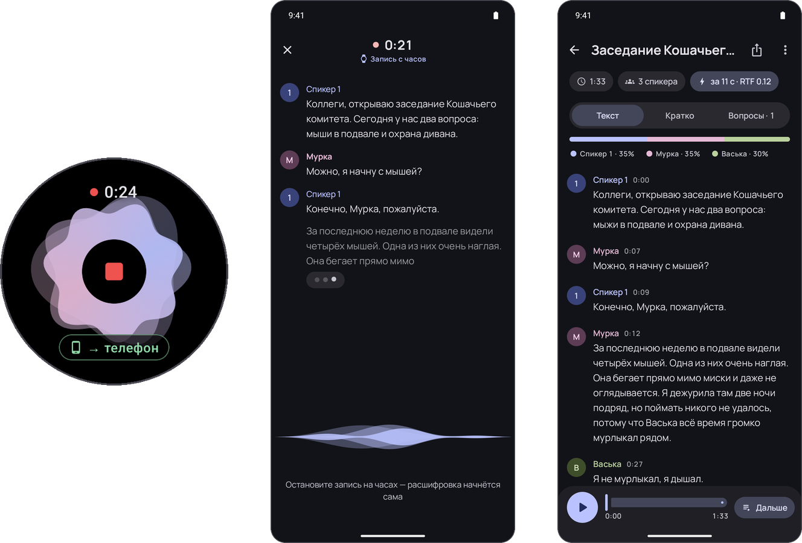

<div align="center">

<h1>KRABER</h1>

Крабер превращает запись разговора в текст: кто говорил, что сказал и когда.<br>
Всё работает на телефоне, без интернета.

<br>



</div>

## Возможности

- Живая расшифровка. Текст появляется прямо во время разговора.
- Спикеры. Нейросеть различает голоса, число людей приложение определяет само.
- Имена. Крабер находит имена в разговоре и подписывает ими реплики вместо Спикер 1.
- Конспект и вопросы. Локальная LLM пишет итоги и отвечает на вопросы по записи.
- Часы. Запись с Wear OS одним нажатием, текст сразу появляется на телефоне.
- Плеер. Нажатие на фразу включает звук с этого места и подсвечивает слова.
- Поиск и экспорт. Поиск по всем записям, экспорт в JSON по ТЗ, TXT и ZIP.
- Приватность. У приложения нет доступа в интернет, все модели внутри APK.

## Результаты

На нашем тестовом наборе WER от 2.8 до 6.3 %, DER от 4 до 7 %, RTF от 0.05 до 0.15. Число спикеров
определяется верно на всех файлах набора и на записях телефоном в комнате с эхом и шумом на 2, 3 и 4 голоса.
Подробнее в [результатах тестов](docs/TEST_RESULTS.md).

## Установка

Скачайте [kraber.apk](https://github.com/maxtaran2010/kraber/releases/download/v1.0/kraber.apk) (1.6 ГБ, модели внутри)
и установите на телефон с Android 9 или новее:

```bash
adb install -r kraber.apk
```

Часы необязательны. [kraber-wear.apk](https://github.com/maxtaran2010/kraber/releases/download/v1.0/kraber-wear.apk)
ставится на часы с Wear OS 3 или новее через отладку по Wi-Fi:

```bash
adb connect <ip-часов>:<порт>
adb -s <ip-часов>:<порт> install -r kraber-wear.apk
```

Часы находят телефон через обычное сопряжение Wear OS по Bluetooth, без аккаунтов и интернета.
Оба APK нужно брать из одного релиза: они подписаны одним ключом.

## Как пользоваться

1. Выберите аудиофайл через импорт или запишите разговор кнопкой записи.
2. Готовая расшифровка откроется сама. Вкладки: Текст, Кратко, Вопросы.
3. Экспорт: значок вверху, затем JSON или TXT. Несколько записей: долгое нажатие, затем ZIP.
4. С часов: большая красная кнопка. Текст сразу идёт на телефон, после остановки запись расшифровывается целиком.
5. В настройках можно выбрать модель для конспекта. Режим Авто берёт Qwen3 1.7B, а если памяти меньше 4.5 ГБ, то Qwen3 0.6B.

## Видео

Ссылка будет добавлена.

## Сборка

```bash
scripts/download_models.sh        # один раз: модели и sherpa-onnx, около 1.5 ГБ
cd src/android
./gradlew :app:assembleRelease    # телефон
./gradlew :wear:assembleRelease   # часы
```

Подробнее в [src/README.md](src/README.md).

## Документы

- [Архитектура и модели](docs/ARCHITECTURE.md)
- [Ограничения](docs/LIMITATIONS.md)
- [Результаты тестов](docs/TEST_RESULTS.md)
- [Презентация](presentation/kraber.pptx)
