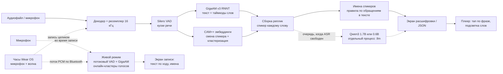

# Архитектура решения

## Контекст

Крабер это Android-приложение для кейса Hex.Team (Nuclear IT Hack 2026). Оно превращает запись разговора
в текст с разделением по спикерам и таймкодами. Всё выполняется на телефоне без интернета: модели встроены в APK,
у приложения нет разрешения `INTERNET`.

Вход: аудиофайл из памяти телефона (wav, mp3, m4a/aac, ogg/opus, flac, то есть всё, что умеет декодировать Android)
или запись с микрофона в приложении. Выход: экран с репликами и экспорт в JSON строго по ТЗ:

```json
{"transcript":[{"speaker_id":"speaker_1","start_ms":1250,"end_ms":4380,"text":"Добрый день!"}]}
```

Кроме того, обязательная локальная LLM пишет название и краткий конспект разговора.

## Компоненты



| Слой | Файлы (`src/android/app/src/main/java/app/glagol/`) | Что делает |
|---|---|---|
| Аудио | `audio/AudioDecoder.kt`, `audio/Resampler.kt`, `audio/WavIO.kt`, `audio/AudioRecorder.kt`, `audio/Player.kt` | Декодирование через MediaExtractor и MediaCodec в mono float; полифазный windowed-sinc ресемплер в 16 кГц (без алиасинга); нормализация громкости; запись с микрофона сразу в WAV 16 кГц; проигрывание с плавной позицией для подсветки слов |
| Живой режим | `ml/LiveTranscriber.kt` | Во время записи: потоковый VAD, GigaAM по каждому куску речи, черновик текущей фразы раз в ~2 с, онлайн-кластеризация голосов, имена через тот же `SpeakerNamer` |
| VAD | `ml/Engines.kt` (`VadEngine`) | Silero VAD v5: находит все куски речи (порог 0.4, пауза 0.25 с, кусок ≤ 20 с) |
| ASR | `ml/Engines.kt` (`AsrEngine`), `ml/Words.kt` | GigaAM v3 RNNT с пунктуацией и регистром (int8, sherpa-onnx). Каждый кусок речи распознаётся целиком, токенные таймкоды собираются в слова |
| Диаризация | `ml/SpeakerClustering.kt`, `ml/Engines.kt` (`SpeakerEmbedder`) | Своя диаризация на эмбеддингах CAM++ (см. ниже) |
| Сборка | `ml/TranscriptAssembler.kt` | Спикер каждому слову; сглаживание дрожания; привязка смены спикера к концу предложения; реплики |
| Имена | `ml/SpeakerNamer.kt` | Имена участников по тексту, по правилам: обращения (Оля, ты с нами?) и самопредставления; голосование, при сомнениях остаётся Спикер N |
| Пайплайн | `ml/TranscriptionPipeline.kt` | Этапы, прогресс, замеры времени (RTF) |
| LLM | `ml/LlmService.kt`, `ml/LlmClient.kt`, `ml/LlmSummarizer.kt`, `ml/SummaryLogic.kt` | Qwen3 1.7B или 0.6B int4 (LiteRT-LM, выбор в `ml/LlmModels.kt`) в отдельном процессе `:llm`: название, конспект (map-reduce для длинных записей), ответы на вопросы |
| Фон | `service/ProcessingService.kt`, `service/ProcessingManager.kt` | Foreground-сервис с прогрессом в уведомлении; очередь файлов; очередь конспектов |
| Данные | `data/RecordingsRepository.kt`, `data/Models.kt` | `filesDir/recordings/<id>/`: `audio.wav`, `meta.json`, `transcript.json`, `words.json` (таймкоды слов для подсветки, в экспорт не идут); `StateFlow` для UI |
| Экспорт | `export/TranscriptExport.kt` | JSON по ТЗ (сохранить через системный диалог или Поделиться), TXT для людей |
| UI | `ui/…` | Jetpack Compose, Material 3, светлая и тёмная тема |
| Приём с часов | `watch/WatchHub.kt`, `watch/WatchListenerService.kt`, `watch/WatchProtocol.kt` | Приём записи с часов по Wearable Data Layer: живой текст по ходу, сверка, полная расшифровка |
| Часы | `src/android/wear/…` (`app.glagol.wear`) | Отдельное приложение Wear OS: запись с микрофона, круговая анимация волны, поток на телефон, очередь неотправленных |

## Пайплайн обработки

1. Декодирование. Любой формат, который поддерживает Android, декодируется в mono float, ресемплируется в 16 кГц
   и нормализуется. Копия сохраняется как `audio.wav`.
2. VAD. Silero VAD находит всю речь. Выбрасывается только тишина.
3. ASR по кускам речи. GigaAM v3 получает кусок целиком (±0.1 с запаса) и выдаёт текст с пунктуацией и токенные таймкоды.
   Из токенов собираются слова с началом и концом. Тире, которое GigaAM ставит в начале новой реплики, служит подсказкой
   о смене говорящего и удаляется из текста.
4. Диаризация. Своя, поверх эмбеддингов CAM++ из 3D-Speaker (подробнее ниже).
5. Сборка реплик. Каждому слову достаётся спикер куска с наибольшим перекрытием. Короткие вкрапления (≤ 2 слов
   или < 0.6 с) поглощаются соседями, если это не законченное предложение. Смена спикера сдвигается к ближайшему концу
   предложения (± 2 слова). Реплика заканчивается при смене спикера или паузе > 1 с. Спикеры нумеруются по первому появлению.
6. Имена спикеров. Правила `SpeakerNamer` по тексту расшифровки (подробнее ниже).
7. Конспект. LLM пишет название и конспект (подробнее ниже).
8. Вопросы к разговору. LLM отвечает по расшифровке (подробнее ниже).

Ни одно слово не теряется и не режется пополам из-за ошибок диаризации: текст строится независимо от неё,
диаризация только раскрашивает слова.

## Диаризация

- Смена спикера: эмбеддинги скользящим окном 1.5 с с шагом 0.25 с. Окно сравнивается с соседним через одно окно,
  разрез ставится в локальных минимумах сходства ниже 0.3. Плюс разрезы по тире из ASR.
- Куски речи режутся в этих точках и дополнительно до ≤ 3 с.
- Для каждого куска ≥ 0.5 с считается эмбеддинг, затем идёт агломеративная кластеризация (average linkage, косинусное
  сходство, порог 0.55; или ровно N кластеров, если пользователь указал число спикеров).
- Два прохода уточнения по центроидам.
- Режим Авто: маленький кластер (< max(3 с, 4 %) речи) присоединяется к соседу, только если похож на него по голосу
  (косинус центроидов ≥ 0.4) или совсем крошечный (< min(3 с, 20 % речи)). Так короткий голос в 4-секундной записи
  не теряется.
- Затем в режиме Авто сливаются кластеры с близкими центроидами: это один человек, раздробленный кластеризацией.
  Порог слияния зависит от объёма речи меньшего кластера. До 20 с он равен 0.65: центроид по нескольким секундам живого
  звука шумный (эхо, расстояние, громкость), и один голос легко дробится. К 120 с порог плавно растёт до 0.9: по минутам
  речи центроид надёжен, и близкие, но разные голоса длинного созвона не склеиваются. После этого ещё два прохода уточнения.
- Если число спикеров задано, уточнение не может уменьшить число кластеров. Если кусков для эмбеддингов меньше,
  чем спикеров, самый длинный делится пополам.
- Короткие куски получают метку ближайшего соседа по времени.

## Имена спикеров

Имена находит `SpeakerNamer`: алгоритм на правилах по тексту расшифровки, без LLM, работает за миллисекунды.

- Обращение по имени (вопрос, просьба, приветствие) даёт голос тому, кто заговорил следующим. Пример: Оля, ты с нами?
- Благодарность или согласие с именем даёт голос тому, кто говорил до этого. Пример: Спасибо, Дань.
- Самопредставление даёт голос самому говорящему. Пример: меня зовут Ольга.
- Тот, кто обратился к X, сам точно не X.
- Кандидат в имена: слово из словаря (~150 имён с уменьшительными, Дань считается как Даня) или кличка. Кличка всегда
  пишется с заглавной, окончание у неё как у имени, рядом есть признак обращения.
- Имя присваивается, только если у одного спикера ≥ 60 % голосов за него и голоса за этого спикера не расходятся.
  Иначе остаётся Спикер N.
- Пользователь может переименовать спикера тапом по имени.
- В JSON-экспорт имена не попадают: там `speaker_N` строго по ТЗ.

## Конспект

Конспект запускается в очереди, только когда нет активных расшифровок, поэтому не замедляет распознавание и экспорт.
Если имена известны, LLM видит в тексте имя, например Оля, а не Спикер 2.

- Меньше 25 слов (приветствие): только название, без конспекта, потому что маленькая модель на таком тексте выдумывает.
- До ~2800 символов: один проход в жёстком формате. Название, суть, ключевые моменты списком и раздел договорённостей
  с пунктами о том, кто что сделает.
- Длиннее: map-reduce. Текст режется по границам реплик на части (бюджеты посчитаны токенизатором Qwen3, контекст
  2048 токенов). По каждой части модель пишет 1 или 2 предложения: это хронология с таймкодами, тап по пункту
  проигрывает запись с этого места. Затем итог по частям. В карточке виден прогресс по частям, например 3 из 17.
- Ответ модели разбирается в структуру `Summary` и чистится фильтрами: выдуманные Спикер N, имена и названия,
  которых нет в тексте, неверный автор обещания, эхо шаблона.

## Вопросы к разговору

Короткая расшифровка идёт в промпт целиком. Для длинной используется лексический поиск (окна по ~500 символов,
совпадение основ слов вопроса с весом idf) плюс Суть и хронология. Если ни одного значимого слова вопроса в тексте нет,
приложение сразу, без вызова модели, отвечает, что в записи об этом не говорили.

Под ответом показывается цитата-источник, проверенная по расшифровке; автор цитаты берётся из расшифровки, а не у модели.
Уточняющие вопросы (например, А почему?) получают два предыдущих вопроса с ответами. После ответа процесс `:llm` держится
тёплым 60 с, поэтому следующий вопрос не ждёт загрузки модели.

## Живой режим

Во время записи текст появляется на экране сразу, тоже полностью на устройстве.

1. Каждые 50 мс звук с микрофона идёт и в WAV-файл, и в `LiveTranscriber` (канал без блокировки потока записи).
2. Потоковый Silero VAD режет речь по паузам (≥ 0.35 с). Пока человек говорит, раз в ~2 с последние ≤ 10 с речи
   распознаются как черновик (серый текст), если распознавание не отстаёт от реального времени.
3. Законченный кусок речи GigaAM распознаёт целиком; тире модели делит его на реплики.
4. Онлайн-кластеризация голосов: эмбеддинг CAM++ каждой части ≥ 0.5 с сравнивается с центроидами уже известных голосов.
   При сходстве ≥ 0.45 это тот же спикер (центроид уточняется), иначе новый (часть ≥ 1 с, не больше 6 голосов).
5. После каждого куска `SpeakerNamer` ищет имена по уже распознанному тексту. Найденное имя анимированно заменяет
   Спикер N на экране (подсветка цвета спикера, буква в аватаре, всплывающий чип).
6. После остановки живой текст остаётся на экране. Кнопка Расшифровать начисто запускает полный пайплайн (глобальная
   кластеризация точнее онлайн-версии). Живой режим служит предпросмотром: WER/DER итоговой расшифровки он не меняет.

## Часы (Wear OS)

Модуль `src/android/wear`: маленькое приложение для часов (Wear Compose Material 3), которое только записывает
и передаёт звук. Всё распознавание идёт на телефоне.

1. Тап по кнопке запускает запись с микрофона часов в WAV 16 кГц (foreground-сервис, экран не гаснет). На экране круговая
   волна из трёх слоёв синусоид, амплитуда следует за громкостью.
2. Одновременно часы находят телефон с Крабером (`CapabilityClient`, метка `glagol_phone`) и открывают канал
   `ChannelClient`, прямой поток между часами и телефоном по Bluetooth. Звук идёт кадрами по 50 мс в G.711 μ-law:
   128 кбит/с, вдвое меньше сырого PCM, Bluetooth-канал успевает, на точность не влияет (см. `docs/TEST_RESULTS.md`).
   Канал по Bluetooth открывается не сразу, поэтому очередь на часах держит 2 мин звука с первого сэмпла, и при позднем
   подключении телефон получает всё с начала.
3. Телефон (`WatchListenerService`, затем `WatchHub`) пишет WAV и сразу гонит звук через тот же `LiveTranscriber`,
   что и при записи с микрофона. Он сам открывает экран записи с часов с живым текстом и именами.
4. Стоп на часах отправляет кадр END с числом сэмплов. Телефон сверяет его с полученным, ставит запись в обычную полную
   расшифровку и отвечает ACK по тому же каналу. После этого часы удаляют свою копию.
5. Надёжность. Часы всегда пишут свою копию и хранят её до ACK. Если связи не было или она оборвалась, поток прекращается,
   а после Стоп запись уходит целиком (режим FILE). Без телефона запись лежит на часах и отправляется сама, когда
   он появится. Телефон помнит принятые сессии и на повтор отвечает ACK без дубля.

Протокол (`WatchProtocol.kt`, одинаковый файл в обоих модулях). Часы шлют заголовок (magic, версия, id сессии, частота,
время, режим LIVE/FILE), затем кадры AUDIO (PCM16, режим FILE) или ULAW (μ-law, живой поток; телефон сразу раскодирует
в PCM16), затем END (число сэмплов). Телефон отвечает ACK или NACK.

Для эмуляторов без пары по Bluetooth в debug-сборках тот же протокол идёт по TCP через `adb forward`
(`watch/DebugBridge.kt`, `scripts/wear_install.sh`). В release этого нет.

## Проигрывание

- Тап по реплике проигрывает запись с её начала. В режиме Дальше звук играет до конца записи, в режиме Фраза останавливается в конце реплики.
- Таймкоды слов из ASR сохраняются в `words.json`. Во время проигрывания текущее слово подсвечивается плашкой цвета
  спикера, которая плавно переезжает от слова к слову. Сказанные слова темнеют, звучащая реплика выделяется фоном,
  список сам прокручивается за звуком, если пользователь не листает.
- Позиция `MediaPlayer` обновляется рывками, поэтому между обновлениями она экстраполируется по часам (60 к/с).
- Для записей, сделанных до появления `words.json`, время слов распределяется внутри реплики пропорционально длине.

## Основные технические решения

| Решение | Почему |
|---|---|
| GigaAM v3 RNNT с пунктуацией (Сбер, sherpa-onnx, int8, 230 МБ) | Лучший открытый WER для русского; сразу пунктуация и регистр, как в примере ТЗ. Трансдьюсер даёт таймкоды токенов, из них получаются таймкоды слов |
| Сначала VAD и ASR, потом диаризация | В первой версии ASR шёл по сегментам pyannote, и при ошибке сегментации терялась речь. Теперь текст не зависит от диаризации |
| Своя диаризация на CAM++ вместо pyannote | На наших тестах pyannote-segmentation со стандартной кластеризацией sherpa давали DER от 13 до 28 %, своя от 4 до 7 % (`docs/TEST_RESULTS.md`), и она в несколько раз быстрее |
| Число спикеров Авто по умолчанию | Эксперты не будут ничего настраивать. Пороги подобраны на тестовом наборе, коротких диалогах (4 с), монологах и 52-минутном созвоне (6 участников): монолог не дробится, короткий второй голос не теряется. Вручную можно указать от 1 до 6 (при 1 диаризация пропускается) |
| Живой режим как предпросмотр, итог из полного пайплайна | Онлайн-кластеризация не видит будущего и ошибается чаще глобальной; итоговая расшифровка и JSON всегда из полного прохода |
| LLM не меняет текст реплик | Чтобы не ухудшить WER и не выдумать слов. LLM только пишет название и конспект |
| Qwen3 1.7B int4 через LiteRT-LM | Лучшее качество русского среди моделей, которые помещаются в память телефона; 0.6B писал заметно хуже. Контекст ограничен 2048 токенами (KV-кэш ≈ 0.5 ГБ) |
| Вторая модель Qwen3 0.6B, выбор Авто по ОЗУ | Тестовый стенд: эмулятор с 4 ГБ, где процесс 1.7B занимает 1.9 ГБ и система выгружает ради него всё остальное. Авто (по умолчанию) берёт 0.6B, если ОЗУ < 4.5 ГиБ или `isLowRamDevice`. Если 1.7B дважды убили по памяти, запрос повторяется на 0.6B, и Авто дальше выбирает её. В настройках модель можно выбрать вручную. В памяти хранится копия только одной модели |
| LLM в отдельном процессе `:llm` | Если движок LLM упадёт (нехватка памяти, неподдерживаемые инструкции процессора), расшифровка и приложение не пострадают. Если процесс упал на CPU, запрос повторяется на GPU. Бэкенд помечается неработающим только при настоящем нативном падении (по `ApplicationExitInfo`), а не когда система выгрузила процесс из-за памяти |
| Модели в APK, `noCompress` | Требование ТЗ. sherpa-onnx читает модели прямо из APK; LLM один раз копируется во внутреннюю память (LiteRT-LM нужен путь к файлу) |
| Только `arm64-v8a` | Все современные телефоны; меньше APK |
| Файлы и kotlinx.serialization вместо БД | Проще и надёжнее для хакатона; каждая запись хранится в своей папке, её легко отладить |

## Зависимости

| Компонент | Версия | Лицензия |
|---|---|---|
| [sherpa-onnx](https://github.com/k2-fsa/sherpa-onnx) (AAR, onnxruntime внутри) | 2.0.1 | Apache-2.0 |
| GigaAM v3 RNNT punct (`sherpa-onnx-nemo-transducer-punct-giga-am-v3-russian-2025-12-16`) | 2025-12-16 | MIT |
| Silero VAD | v5 | MIT |
| 3D-Speaker CAM++ (`3dspeaker_speech_campplus_sv_zh_en_16k-common_advanced`) | | Apache-2.0 |
| [LiteRT-LM](https://github.com/google-ai-edge/LiteRT-LM) | 0.19.1 | Apache-2.0 |
| Qwen3-1.7B (`litert-community/Qwen3-1.7B`, int4) | | Apache-2.0 |
| Qwen3-0.6B (`litert-community/Qwen3-0.6B`, int4), для устройств с 4 ГБ ОЗУ | | Apache-2.0 |
| Kotlin, Jetpack Compose (BOM 2026.09.00), Material 3, Navigation, kotlinx.serialization, coroutines | см. `src/android/gradle/libs.versions.toml` | Apache-2.0 |
| Wear Compose Material 3 (часы) | 1.7.1 | Apache-2.0 |
| Google Play Services Wearable (Data Layer, связь часов с телефоном) | 20.0.1 | Android SDK License |

Модели и AAR не хранятся в Git: их один раз скачивает `scripts/download_models.sh` (нужен интернет на машине сборки).

## Безопасность и приватность

- Нет разрешения `INTERNET`: оно удалено из итогового манифеста через `tools:node="remove"`, даже если его добавит
  библиотека. Приложение физически не может отправить данные в сеть. Проверка: `aapt2 dump permissions app.apk`.
- Все модели внутри APK, во время работы ничего не скачивается. Приложение работает в авиарежиме, так и показываем на защите.
- Записи и расшифровки лежат только во внутренней памяти приложения (`/data/data/app.glagol/files`), недоступной
  другим приложениям. Наружу они попадают только по явному действию пользователя: Сохранить JSON или Поделиться.
- Нет аккаунтов, аналитики, рекламы и сторонних SDK с сетевым доступом.
- Часы и телефон связаны только каналом `ChannelClient` Wearable Data Layer между сопряжёнными устройствами
  (Google Play Services, Bluetooth). У приложения на часах в release-сборке тоже нет `INTERNET`. Для полной изоляции
  можно включить авиарежим, оставив Bluetooth включённым на обоих устройствах.
- Удаление записи удаляет папку целиком (аудио, текст, конспект, вопросы).
- Экспорт нескольких записей (`export/ZipExport.kt`) собирается во внутренний кэш приложения и отдаётся только через
  системные Поделиться или Сохранить как. Старые архивы удаляются при следующем экспорте.
